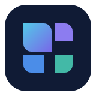
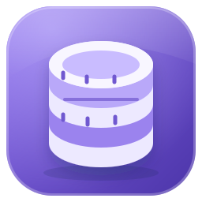
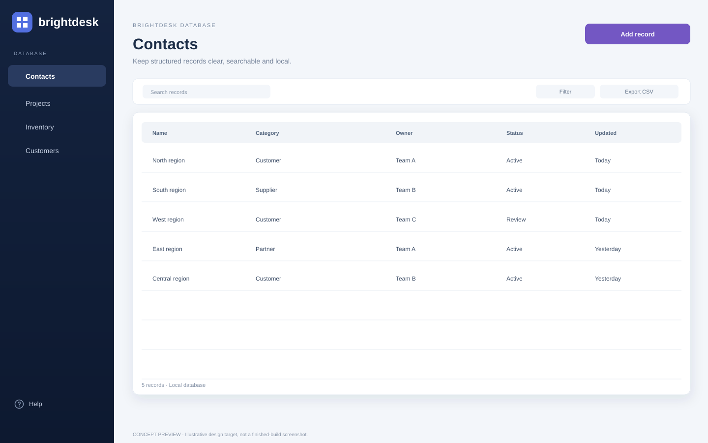

# Brightdesk Database

 <strong>brightdesk</strong>

<strong>Create local tables, define fields, manage records and export data.</strong>

Select the preview to open the full-size artwork.

> **Concept artwork — not a screenshot.** The preview above is original Brightdesk design artwork, not a capture from the running desktop build. A genuine screenshot will be added only after the current product window has been launched and its primary workflow checked.

Brightdesk Database is a dedicated desktop application within the independent Brightdesk Office Suite. It uses the shared Brightdesk design language and opens directly into Database.

## Shared Brightdesk design standard

Follow the local [approved design brief](docs/BRIGHTDESK_DESIGN.md) and canonical Brightdesk visual standard. The approved Database accent is `#8058B3`; use the original SVG icon and retain the shared light canvas, navy navigation and white work surfaces.

## Current first-use workflows

- Create, rename and delete local tables.
- Add fields with supported text, number, date, email, web address, checkbox and choice-list types.
- Add, edit, search, sort and delete records, with validation for required values.
- Export a table to CSV and keep the database data on this device.

**Not included in this first version:** SQL query execution, table relationships, a query designer, form/report designers, database import, online hosting and collaboration.
## Cross-platform desktop packages

All supported desktop editions use the same approved Brightdesk interface and product scope. Each product keeps its approved icon and accent on Windows, macOS and Linux. Only operating-system integrations such as window chrome, native dialogs, keyboard conventions, permissions and packaging may vary.

| Platform | Configured package target |
| --- | --- |
| Windows | x64 NSIS installer (.exe) |
| macOS | Universal disk image (.dmg), package installer (.pkg) and archive (.zip) |
| Linux | x64 AppImage (.AppImage) and Debian package (.deb) |

These are configured build targets, not confirmation that installers are published or have passed native verification. Build and verify each package on its target operating system before describing it as available. Release checks must cover installation, first launch, upgrade, launch after upgrade and removal. Removing Brightdesk must not silently delete local project data.

The customer-facing release version and release approval are managed centrally by Brightdesk Office Suite. Publishing remains a separate manual action.
## Quality and security

Pull requests and pushes run the product and shared-engine test suite, verify the dependency lock and third-party licences, check release preflight and block high-severity dependency vulnerabilities. The same checks repeat daily. Dependabot checks npm packages and GitHub Actions weekly.

## Run from source

Use Node.js **24.22.2**.

    npm ci
    npm start

To build and verify an installer on its native operating system:

    npm run dist:product:mac
    npm run verify:product:mac

Use win on Windows or linux on Linux instead of mac.

## Project structure

- src/ — Brightdesk desktop renderer and product modules.
- `src/branding/icons/database.svg` — original Brightdesk Database application icon.
- `src/branding/previews/database.svg` — workspace concept preview.
- scripts/ — build and release verification tools.
- tests/ — automated product and shared-engine tests.

## Related project

[Brightdesk Office Suite](https://github.com/connormolloy12/Brightdesk-suite) brings all ten approved Brightdesk products together in one desktop installer.

## Identity and licence

Brightdesk is independent and is not affiliated with Microsoft. It uses original product names, code, interface design and artwork. See LICENSE, TERMS_AND_CONDITIONS.txt and THIRD_PARTY_NOTICES.md.
